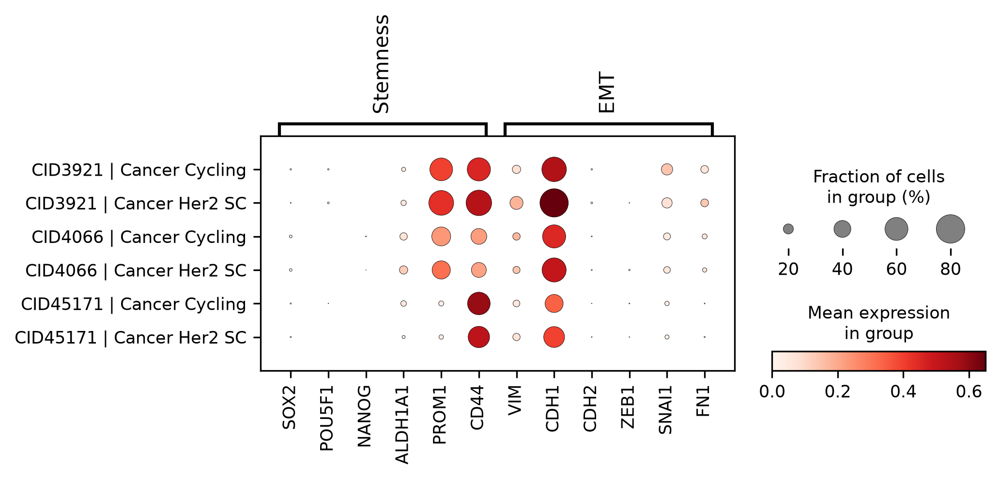

# Mapping Stemness- and EMT-Associated Gene Expression in HER2+ Breast Cancer at Single-Cell Resolution

An exploratory, fully reproducible analysis of public single-cell RNA-sequencing data. It describes how selected cancer stem cell (CSC)-associated and epithelial-to-mesenchymal transition (EMT)-associated genes are expressed in malignant epithelial cells from three HER2-positive breast tumours.



*Malignant epithelial cells from three HER2+ tumours (GSE176078), split into two annotated states: Cancer Her2 SC and Cancer Cycling. Dot size = % of cells with detectable expression; colour = mean log-normalised expression. All rows share one colour scale.*

---

## Background and motivation

Breast tumours are heterogeneous. Within a single tumour, malignant cells can occupy different transcriptional states. Cancer stem cell-like properties (self-renewal, tumour-initiating capacity) and EMT programmes have both been linked to metastasis, therapy resistance and recurrence. Bulk RNA-seq averages over all cells in a tumour, so it cannot show *which* malignant cells express these programmes, or how widely. Single-cell RNA-seq can.

HER2-positive breast cancer is treated with HER2-targeted therapies, but resistance and relapse remain clinical problems. CSC-like and EMT-like cell states are among the proposed contributors. A careful description of how commonly used CSC and EMT marker genes behave in HER2+ malignant cells is a useful first step before more complex modelling. It also shows what these markers can and cannot tell us at single-cell resolution.

## Research questions

1. Which candidate stemness- and EMT-associated genes are detectable in malignant epithelial cells of HER2+ breast tumours?
2. Do their detection rates and expression levels differ between annotated malignant states (Cancer Her2 SC vs Cancer Cycling) within a patient?
3. Are any within-patient patterns consistent across patients?

## Data

- **Dataset:** GEO [GSE176078](https://www.ncbi.nlm.nih.gov/geo/query/acc.cgi?acc=GSE176078). Wu, S.Z. *et al.* (2021). *A single-cell and spatially resolved atlas of human breast cancers.* **Nature Genetics** 53, 1334–1347.
- **Cell annotations:** author-provided (`celltype_major`, `celltype_minor`). No re-clustering was done.
- **Patient selection:** all five clinically HER2+ tumours in the dataset were screened using metadata only ([`HER2_patient_screening.csv`](results/tables/HER2_patient_screening.csv)).

| Patient | Total cells | Malignant epithelial | Cancer Her2 SC | Cancer Cycling | Included |
|---|---:|---:|---:|---:|---|
| CID3921 | 3,024 | 441 | 377 | 64 | Yes |
| CID4066 | 5,309 | 521 | 393 | 112 | Yes |
| CID45171 | 2,447 | 813 | 567 | 236 | Yes |
| CID3586 | 6,178 | 0 | – | – | No (no annotated malignant epithelial cells) |
| CID3838 | 2,353 | 0 | – | – | No (no epithelial cells) |

Small additional malignant groups (Cancer LumA, LumB and Basal SC; ≤ 9 cells per patient) were excluded, because there are too few cells to summarise.

**Candidate genes**

| Set | Genes |
|---|---|
| Stemness-associated | SOX2, POU5F1, NANOG, ALDH1A1, PROM1 (CD133), CD44 |
| EMT-associated | VIM, CDH1 (E-cadherin), CDH2 (N-cadherin), ZEB1, SNAI1, FN1 |

CDH1 is an *epithelial* gene. It is included because its loss is a hallmark of EMT.

## Methods

Each patient was processed identically and separately with [`scripts/run_analysis.py`](scripts/run_analysis.py) (Scanpy):

1. **Build** a cells × genes count matrix from the GEO files. The script checks that barcodes and metadata are in the same order.
2. **Quality control.** Exploratory thresholds: ≥ 200 detected genes and < 20% mitochondrial counts. Recalculated library sizes matched the authors' metadata exactly. **No cells were removed** in any patient. That is consistent with, but does not prove, filtering before deposition.
3. **Normalisation:** library-size normalisation to 10,000 counts per cell, then log1p, applied once. Raw counts are kept in `layers["counts"]`, and raw and normalised objects are saved separately.
4. **Subset** to malignant epithelial cells in the two states shared by all three patients.
5. **Summarise** each gene per patient × population:
   - **% detected**: share of cells with expression > 0 (how *widespread*);
   - **mean expression**: mean over all cells, zeros included (average signal);
   - **mean in positive cells**: mean over expressing cells only (how *strong* where detected), always reported with the number of positive cells.
6. **Sequencing depth** (median counts and genes per cell) is recorded for each group, because detection rates depend on depth.
7. **Combine** the three patients in one dot plot on a shared colour scale.

The patient, not the cell, is treated as the unit of replication. With three patients the analysis is **descriptive**: no statistical tests were performed.

## Key findings

1. **CD44 and CDH1 are widely detected in malignant cells of all three tumours.** CD44 is detected in 34–69% of cells and CDH1 in 44–80%, depending on patient and state.
2. **The classic pluripotency factors are essentially absent.** SOX2, POU5F1 and NANOG are detected in ≤ 3.6% of malignant cells in every patient; CDH2 and ZEB1 are similarly rare. Because of dropout, this means "not measurable here" rather than biologically absent.
3. **PROM1 varies strongly between patients.** It is detected in 44–67% of malignant cells in CID3921 and CID4066 but only 7–8% in CID45171. Low sequencing depth is an unlikely explanation, because CD44 is still detected in 55–59% of the same CID45171 cells.
4. **The apparent within-patient differences did not replicate.** In the first patient, Cancer Her2 SC cells showed higher detection of CD44 (+8 percentage points), PROM1 (+7) and VIM (+13) than Cancer Cycling cells. In the other two patients these differences shrank to ≤ 4 points and were mostly reversed. In CID3921 and CID4066, the direction of the differences followed which state was sequenced more deeply. Small within-patient detection differences should therefore not be over-interpreted.
5. **CDH1 was the one well-detected gene higher in Cancer Her2 SC than Cancer Cycling cells in all three patients** (+14, +3 and +9 percentage points). In CID4066 this held even though the cycling cells were sequenced *more* deeply. With three patients, a consistent direction would arise by chance 1 time in 4, so this is a hypothesis, not a result.
6. **For CD44 and CDH1, differences are in frequency, not intensity.** Among expressing cells, CD44 and CDH1 levels were almost the same in the two states within every patient (differing by ≤ 0.05 log-units). Differences in their mean expression come from how many cells express them. For less frequently detected genes, positive-cell means rest on few cells and were not interpreted.

**Take-home:** in these HER2+ tumours, commonly used CSC and EMT marker genes show a consistent broad hierarchy (CD44 and CDH1 high; pluripotency factors absent). Patient-to-patient variation, especially for PROM1, is larger than the variation between malignant states within a patient. A single-patient comparison would have produced conclusions that did not hold up. This shows why multiple patients and attention to sequencing depth matter when interpreting marker genes in scRNA-seq.

## Limitations

- Expression of individual markers does **not** establish cancer stem cell identity or function. EMT is continuous and multi-gene, and cannot be classified from a few genes.
- scRNA-seq dropout means zero detection is not evidence of absence. Detection rates depend on sequencing depth, which differed between patients and between states.
- Three patients, all HER2+, from one study and one platform. The results are descriptive and not generalisable, and no statistical tests were done.
- Malignant cell identity and states come from the original authors' annotations.
- Results describe RNA, not protein. CD44 and CD133 (PROM1) are usually assessed at the protein level in functional CSC studies.

## Possible next steps

- Score multi-gene stemness and EMT signatures per cell, rather than relying on single markers.
- Add depth-aware comparisons, e.g. pseudobulk per patient × state, or downsampling to equal depth.
- Extend to ER+ and triple-negative tumours in the same dataset, analysed within subtype.
- Relate CD44/CDH1/PROM1 patterns to the dataset's spatial transcriptomics data.

## Reproducing the analysis

**1. Environment** (tested with Python 3.12 on macOS, Apple M2, 8 GB RAM):
```bash
conda create -n brast-ml python=3.12
conda activate brast-ml
pip install -r requirements.txt
```

**2. Data.** From the GEO page for GSE176078, download the per-sample archives for CID3921, CID4066 and CID45171 (and optionally CID3586 and CID3838, which are used only for screening). Unpack them into `data/raw/`:
```bash
cd data/raw
tar -xzf GSM5354521_CID4066.tar.gz      # repeat for each archive
```
This should give folders such as `data/raw/CID4066/` containing `count_matrix_sparse.mtx`, `count_matrix_genes.tsv`, `count_matrix_barcodes.tsv` and `metadata.csv`.

**3. Run:**
```bash
python scripts/run_analysis.py
```
This regenerates every file in `results/` and the processed `.h5ad` objects in `data/processed/` in a few minutes, with a peak memory use of about 1 GB. Raw and processed data are not tracked in this repository.

## Repository structure

```text
├── README.md
├── PROJECT_LOG.md              # dated record of every step, decision, check and result
├── requirements.txt
├── scripts/
│   └── run_analysis.py         # full pipeline: raw GEO files -> all figures and tables
├── results/
│   ├── figures/                # QC violins, per-patient and combined dot plots, violin plot
│   └── tables/                 # per-patient summaries, combined long table, screening, depth
└── data/                       # not tracked: raw/ (GEO files), processed/ (.h5ad)
```

**Main outputs**
- `results/figures/AllPatients_HER2_Cancer_Epithelial_Stemness_EMT_DotPlot.png`: main figure
- `results/tables/AllPatients_gene_expression_summary.csv`: one row per patient × population × gene
- `results/tables/AllPatients_sequencing_depth.csv`: median depth per patient × population
- `results/tables/HER2_patient_screening.csv`: patient selection
- `results/figures/<patient>_QC_violin.png` and `<patient>_Cancer_Epithelial_Stemness_EMT_DotPlot.png`

## Author

**Aviral Jain**, dual degree in Biology and Electronics & Communication Engineering, BITS Pilani · GitHub: [aviraljain-tech](https://github.com/aviraljain-tech)

## Citation for the data

Wu, S.Z., Al-Eryani, G., Roden, D.L. *et al.* A single-cell and spatially resolved atlas of human breast cancers. *Nat Genet* **53**, 1334–1347 (2021). https://doi.org/10.1038/s41588-021-00911-1
